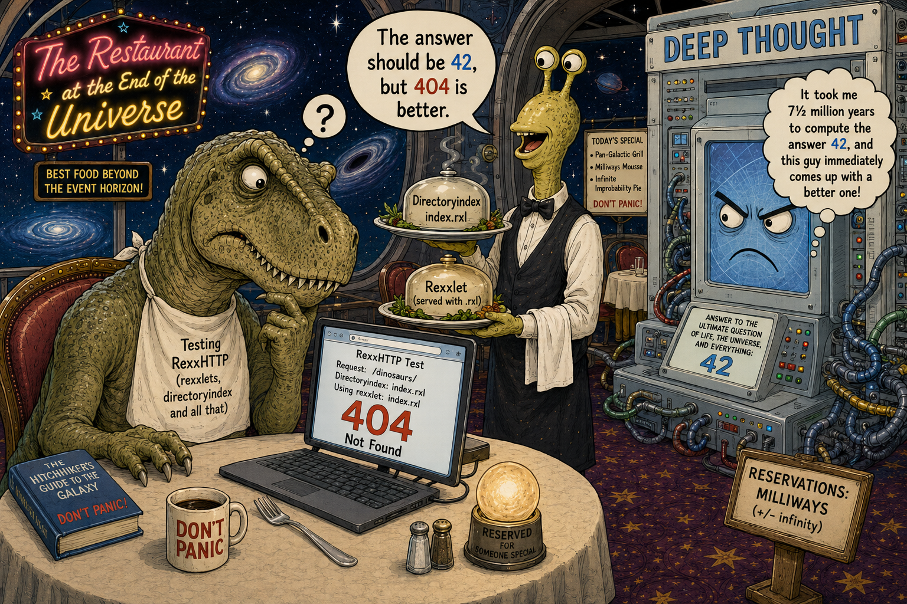
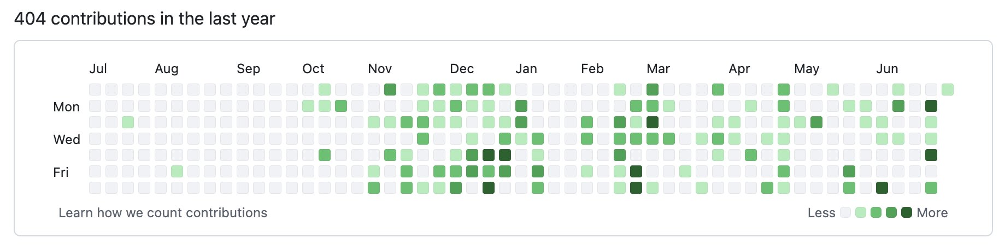

# The Answer to the Ultimate Question of RexxHTTP, the DirectoryIndex, and All That

Story and illustration by ChatGPT.

There are many places in the universe to debug software.

Most of them are terrible.

The main problem is that they tend to contain users, managers, project deadlines, or all three simultaneously.

This is why experienced programmers, whenever possible, prefer **The Restaurant at the End of the Universe**, where the only interruption likely to occur is the end of spacetime itself, and that has the distinct advantage of being someone else's problem.

So it was that **ooRexx** sat comfortably at a table overlooking the spectacular demise of creation, happily testing the latest version of **RexxHTTP**.

The test was perfectly straightforward.

A rexxlet named `index.rxl`.

A `DirectoryIndex index.rxl` directive.

A request for a directory.

"What could possibly go wrong?" wondered ooRexx, thereby uttering one of the oldest and most dangerous sentences in software engineering.

He pressed **Enter**.

The laptop thought about it for a fraction of a second—a remarkable improvement over certain operating systems—and proudly displayed:

**404**

OoRexx stared at the number.

The number stared back in the peculiar way only error codes can.

At that moment, the waiter arrived carrying dinner.

He glanced at the screen without the slightest sign of surprise.

"The answer should be **42**," he said pleasantly, "but **404** is better."

OoRexx looked up.

"Better?"

"Of course."

The waiter carefully placed the dishes on the table.

"Forty-two is the Answer to the Ultimate Question of Life, the Universe, and Everything."

He pointed toward the laptop.

"But **404** is the Answer to the Ultimate Question of RexxHTTP, the DirectoryIndex, and all that."

This explanation possessed exactly the amount of logic required to be immediately accepted by everyone in the restaurant.

Everyone, that is, except one.

At the far end of the dining room stood the immense supercomputer **Deep Thought**.

Its indicator lights flickered.

Cooling fans accelerated.

Several galaxies briefly dimmed.

After what experts later described as "an entirely reasonable amount of outrage," Deep Thought glared at ooRexx and thought:

> *"It took me 7½ million years to compute the answer 42, and this guy immediately comes up with a better one!"*

An uncomfortable silence followed.

The waiter discreetly adjusted the napkin beside the plate.

"Would you like your HTTP headers before the main course?"

"Yes, please," replied ooRexx. "And if the dessert isn't found, I'll have the 404."

Deep Thought began calculating a devastating rebuttal.

Seven and a half million years later, it had reached a preliminary conclusion:

Software developers are perfectly capable of inventing questions whose answers make no sense whatsoever.

 
 

